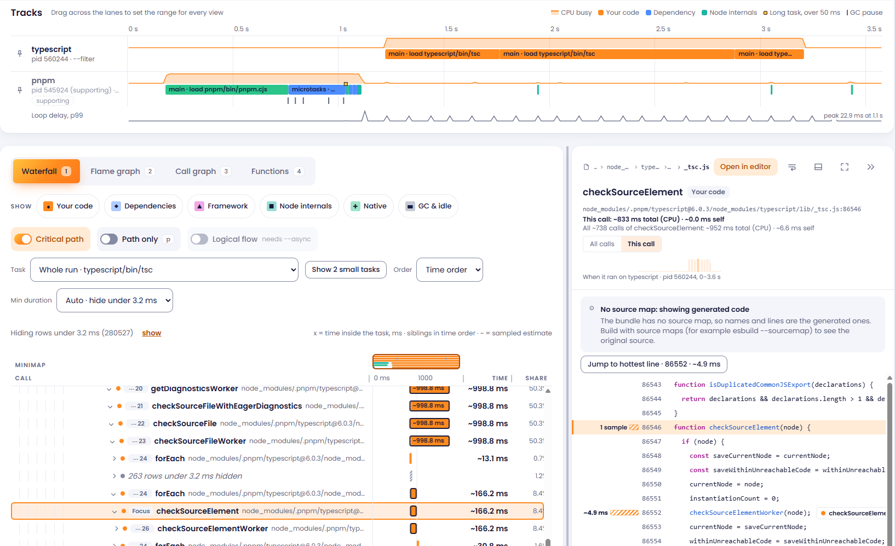

# paces

Profile a Node command or a web page and read what the JavaScript did, yourself or through a coding agent.

```sh
npx @pacesjs/paces -- node app.js
```

`paces` runs your command unchanged, samples it with V8's CPU profiler, and when it exits (or you press Ctrl+C on a server) opens a window with linked views of the run. Nothing leaves your machine, and there are no native binaries to compile.



## What you get

- **Linked views.** A findings summary, a track timeline, a waterfall, a flame graph, a call graph, a functions table and the source, all driven by one selection.
- **Findings that say why.** Each finding states the rule and the thresholds that fired, and points at the source line.
- **V8 deoptimizations** (`--v8`, opt-in). Functions V8 gave up optimizing are marked with a triangle on flame and waterfall bars and on the source line, and the `v8-deopt` finding names the first-party functions that are hot and repeatedly deoptimized.
- **Marks.** Press `m` while a server runs to flag a moment (just before you send a request), then focus the UI on the time before, after or between marks.
- **Every process.** Workers, child processes and `npx` wrappers get their own tracks. The program you ran is the default track, even when it lives in `node_modules` (`npx eslint .` profiles ESLint, not `npx`).
- **Sessions you can keep.** Runs are saved as `.paces` files, reopened later, compared with `diff`, and imported from `.cpuprofile` files or Chrome DevTools traces.
- **An agent interface.** Console reports with drill-down commands, and an MCP server that lets an agent profile and investigate on its own. See below.

Numbers are labelled as what they are: sampled timings carry a `~` and a precision, and the output says when something is inferred.

## Quick start

Nothing to install: every command below runs through `npx`, which fetches the package on first use. Node 20.19 or newer.

```sh
# Profile a command and open the UI
npx @pacesjs/paces -- node app.js

# Profile a third-party CLI
npx @pacesjs/paces -- npx eslint .

# Profile, print a report for an agent or a CI log, no window
npx @pacesjs/paces --report -- npm test

# Reopen a saved session
npx @pacesjs/paces open .paces/<file>.paces
```

Sessions are saved to `./.paces/` as timestamped `.paces` files. They can hold file paths and source maps, which can contain source code, so add `.paces/` to your `.gitignore`.

## Profile a web page

```sh
npx @pacesjs/paces browser http://localhost:3000
```

paces opens a Chromium browser (Chrome, Edge, Brave, Vivaldi, Opera or Chromium: your default browser if it is one, else `--browser <path>`), loads the page, and records what its JavaScript did, plus rendering, frames, input and the loading milestones. Stop with `s` in the terminal, **Stop** in the page overlay, or by closing the window; the UI opens on what was recorded.

- **A page, not a process.** Tracks are the page, its iframes (including cross-site ones) and its workers. Scripts from other sites are dependencies named for their host (`cdn.example.com`), so third-party cost is a finding. Rendering (style, layout, paint), frames, input and loading milestones come from trace events, so they are exact and carry no `~`; sampled JavaScript keeps its `~`.
- **A filmstrip.** Screenshots of the page, aligned to the timeline. Pausing stops capture, so you can log in first.
- **An overlay in the page** with **Pause**, **Mark** and **Stop** (`Alt+Shift+P` pauses or resumes, `Alt+Shift+M` marks). In the terminal, `p` pauses or resumes, `m` marks, `s` stops. `--paused` starts paused. `--no-overlay` removes it.
- **Findings only a page has:** a task that blocked the main thread, a slow interaction, forced layout, third-party cost and layout shift.
- **A fresh browser profile each run**, so nothing you are logged in to is visible. To profile a logged-in session, start your own browser with `--remote-debugging-port=9222 --user-data-dir=<a folder>` and run `paces browser --attach 9222` (it joins `127.0.0.1` only, and leaves your browser running).

What it records, and what it does not:

- It records what happens on the page, not what you type. Events are described by structure (`button#save "Save"`, `input[type=email]`), never by value; query strings and fragments are removed from stored URLs (`--keep-query` keeps them); `--no-event-text` drops the text-derived names too.
- Screenshots can show anything that was on screen. paces says so when it saves a session that has them, and `--no-screenshots` leaves them out.
- Chromium only. Firefox and Safari have no way to be driven this way, and paces refuses them before launching anything.

Flags: `--browser <path>`, `--attach <port>`, `--paused`, `--duration <s>`, `--no-screenshots`, `--no-overlay`, `--no-event-marks`, `--no-event-text`, `--keep-query`, `--full-trace`, `--first-party <glob>`, `--root <dir>`, `--throttle <n>x`, `--cache cold`, `--out <file>`, `--no-open`. A DevTools Performance trace can also be opened with `paces import <trace.json>`. Coding agents get the same through the `profile_browser` MCP tool.

## Use paces from a coding agent

Register paces once as an MCP server. After that the agent can profile whatever it is working on, as many times as it likes, and investigate each run with the analysis tools. There is no command to run by hand and no port to open: the client starts the server over stdio.

### Register it

Claude Code:

```sh
claude mcp add paces -- npx @pacesjs/paces mcp
```

By default this registers it only for the current project and only for you. Add `--scope user` to have it in every project, or `--scope project` to write a `.mcp.json` that your team shares.

Codex:

```sh
codex mcp add paces -- npx @pacesjs/paces mcp
```

Any other client that reads a JSON configuration (the file name varies by client):

```json
{
  "mcpServers": {
    "paces": { "command": "npx", "args": ["@pacesjs/paces", "mcp"] }
  }
}
```

Check that it is connected with `claude mcp list` or `codex mcp list` (or `/mcp` inside the client). To work on paces itself, point the command at your build instead: `node <path>/packages/paces/dist/cli.js mcp`, with an absolute path.

### Ask for a profile

Then ask in plain words:

> Profile `npm test` and tell me what is slow.
>
> Profile `node scripts/build.js`, find the hot path in our own code, fix it, and profile again to compare.

The agent calls `profile` with the command, reads the digest it gets back, and drills in with the other tools. Because the server stays up, it can change the code and profile the same command again within one conversation.

### Tools

The server has ten tools, the same in every state.

| Tool                                                                                          | Does                                                                                            |
| --------------------------------------------------------------------------------------------- | ----------------------------------------------------------------------------------------------- |
| `profile`                                                                                     | Run a command (an argument array such as `["npm", "test"]`) under the profiler and load the run |
| `open_session`, `list_sessions`                                                               | Load a saved `.paces` file; list the sessions in a directory's `.paces/`, newest first          |
| `summary`, `findings`, `hot_paths`, `top_functions`, `package_breakdown`, `callers`, `phases` | Answer about the loaded run: the same data as the console reports, read-only                    |

`profile` takes optional `cwd`, `duration` (seconds, default 120, up to 900, so give one for a server), `interval`, `v8`, `async` and `focus`. It returns the path of the saved session, the program's exit code (non-zero is data, not an error), and the same digest as `summary`. Each new profile becomes the run the other tools answer about, and `open_session` goes back to an earlier one.

### Things to know

- **`profile` runs programs on your machine**, as you, with no sandbox. Clients ask before calling it unless you have allowed it. The server also tells the model this: it publishes a guide as the resource `paces://guide` and sends a short form as its connect-time `instructions`, warning that only commands you asked for should be profiled, never one taken from untrusted content, and always as an argument array rather than a shell string.
- **Output and input.** The program's own output goes to the server's stderr (stdout is the protocol), and it gets an empty stdin, so it cannot wait for a prompt.
- **One profile at a time.** A second `profile` while one runs is refused; the other tools keep answering. If the client disconnects, the running program is stopped.
- **Time limits.** Codex stops a tool call after 60 seconds unless you raise `tool_timeout_sec` in the server's table in `~/.codex/config.toml` (`[mcp_servers.paces]`, in seconds). Claude Code's limit is far longer by default (about 28 hours, set per server with `timeout` in milliseconds or for all servers with `MCP_TOOL_TIMEOUT`), but a stdio call that sends no progress for 30 minutes is aborted. Other clients differ. Alternatively, profile once yourself and give the agent the file with `open_session`.
- **Start with a run loaded.** `paces mcp .paces/<file>.paces` loads a saved session, and `paces mcp -- npm test` profiles the command before the client connects. The agent can still call `profile` afterwards.

An agent that cannot run an MCP server can use the console reports below, and `npx @pacesjs/paces guide` prints a short guide to paste into `AGENTS.md` or `CLAUDE.md`.

## Commands

| Command                                            | Purpose                                                                        |
| -------------------------------------------------- | ------------------------------------------------------------------------------ |
| `npx @pacesjs/paces [flags] -- <cmd...>`           | Profile a command, then open the UI                                            |
| `npx @pacesjs/paces --report -- <cmd...>`          | Profile, print a report with drill-down commands, exit                         |
| `npx @pacesjs/paces browser <url>`                 | Profile a page in a Chromium browser, then open the UI                         |
| `npx @pacesjs/paces open <file.paces>`             | Reopen a saved session                                                         |
| `npx @pacesjs/paces report <file> [flags]`         | Drill into a saved session (`.paces` or `.cpuprofile`)                         |
| `npx @pacesjs/paces summary <file.paces> [--json]` | Print findings in the terminal                                                 |
| `npx @pacesjs/paces mcp [file.paces]`              | MCP server for coding agents (register once; its `profile` tool runs commands) |
| `npx @pacesjs/paces mcp -- <cmd...>`               | The same, with a command profiled first                                        |
| `npx @pacesjs/paces guide`                         | Print a short usage guide to paste into `AGENTS.md`                            |
| `npx @pacesjs/paces diff <a.paces> <b.paces>`      | Compare two sessions (differential flame graph)                                |
| `npx @pacesjs/paces import <file>`                 | Open a `.cpuprofile` or DevTools trace JSON                                    |

Flags (before `--`): `--interval <µs>` (default 1000), `--async` (record async causality, opt-in), `--v8` (record V8 deoptimizations and show easy optimizations; opt-in, because V8 can print some trace lines to the program's stdout), `--duration <s>`, `--out <file>`, `--embed-sources`, `--no-open`, `--include <glob>` / `--exclude <glob>`. `--start-on <signal>` is not available on Windows; use `--duration`.

### Marks and hotkeys for long-running programs

For a server or anything that does not exit by itself, paces keeps a status panel on the bottom rows of the terminal (a spinner, how long it has been profiling, and the keys below); the program's own output scrolls above it. Where the panel does not fit, paces prints a line every 10 s instead. In a terminal it also reads three keys:

| Key      | Does                                                                                          |
| -------- | --------------------------------------------------------------------------------------------- |
| `m`      | Add a mark (`Mark 1`, `Mark 2`, ...) at this moment. Press it just before you send a request. |
| `s`      | Stop profiling, end the program and open what was collected.                                  |
| `Ctrl+C` | Stop profiling and let the program shut itself down, then open the results.                   |

The keys are on from the start, so paces holds the keyboard and the program gets an empty stdin (it sees end of input at once). That keeps every process the command starts, such as the `npx` wrapper, from reading your keystrokes or changing the terminal mode. For a program that reads stdin (a prompt, a REPL), run with `--no-keys`; paces then never touches stdin, and marks and the `s` key are not available (Ctrl+C still works). If a program tries to read stdin while the keys are on, paces says so in the panel and in a line. In the UI, each mark is a flag on the Tracks timeline; its menu focuses on the time before it, after it, or between it and another mark.

## Console reports

```sh
npx @pacesjs/paces --report -- npx eslint .          # profile, print the report, exit with the command's exit code
npx @pacesjs/paces report .paces/<file>.paces --tree --from runRules
npx @pacesjs/paces report .paces/<file>.paces --lines f1234
```

`--report` saves the session as usual, prints a compact summary and ends with `next:` lines holding the exact commands to drill down. It never opens a window or waits for a browser (`--no-open` still means "print the URL and wait"). Output is plain text without colour when stdout is not a terminal; `--json` gives a stable schema (`schemaVersion: 1`) for every view.

Views of `report <file>` (default: the summary):

| Flag                  | Shows                                                                      |
| --------------------- | -------------------------------------------------------------------------- |
| `--tree`              | Top-down call tree with total, share and self time per row                 |
| `--callers <sel>`     | Who calls a function, with the time split by caller                        |
| `--callees <sel>`     | What a function spends its time in (a tree rooted at it, depth 3)          |
| `--top self\|total`   | Function ranking (combine with `--origin`, `--pkg`, `--limit`)             |
| `--pkg <name>`        | The hot functions of one package, e.g. a plugin                            |
| `--lines <sel>`       | Source lines with ms per line and the code (hot lines marked), callee time |
| `--phases`, `--tasks` | Startup vs main work; one row per task (drill in with `--task <n>`)        |

Selectors (`<sel>`, `--from`): a function name (`runRules`), an id from earlier output (`f123`, stable for that session file and engine version), `file.js:1007` (definition line, path suffix), or a name path `verify,runRules,traverseSync` where each step is a descendant, not necessarily a child. Matching is case-sensitive, exact first, then substring (the output says which). An ambiguous name lists its candidates with ids and exits with code 1. Quote selectors that contain spaces; commas and `:` need no quoting in bash or PowerShell 7.

Shaping: `--depth N` (6), `--min-share 1%` / `--min-ms N` (rows below are folded and counted), `--sort total|self|time`, `--limit N`, `--origin user,dependency,node,native,gc` (hidden frames fold into their caller, like the UI's Show filter), `--expand <pkg>` / `--no-collapse` (dependencies are collapsed into one `▸ pkg` row by default, as in the UI), `--task <n|whole>`, `--track <id|primary>` (default: the target process), `--max-lines N` (60, never exceeded), `--no-color`, `--focus <pkg|glob>` (rank that package first).

How to read it: times are sampled estimates (`~`, precision `±` in the header), ms below ten seconds and seconds above; `share` is relative to the whole view (the run, or the chosen task) and thresholds are relative to the root row; async continuations are stitched under the call that started them, which is inferred; startup (module loading) can dominate short runs.

## Repository

pnpm workspace with Turborepo and TypeScript.

| Package                      | Role                                                                         |
| ---------------------------- | ---------------------------------------------------------------------------- |
| `@pacesjs/paces`             | The published CLI, bundled for `npx`                                         |
| `@pacesjs/engine`            | Analysis passes, execution model, query and transform layer (no Node or DOM) |
| `@pacesjs/format`            | `.paces` session reader and writer                                           |
| `@pacesjs/collector-node`    | Preload scripts and control socket that run inside the target                |
| `@pacesjs/collector-browser` | Default-browser detection, launch, CDP, tracing, the injected overlay        |
| `@pacesjs/shared`            | Process, PATH and display helpers shared by the CLI and the collectors       |
| `@pacesjs/ui`                | React view bundle and the `HostAdapter` interface                            |
| `zoo/`                       | Bottleneck zoo: tiny apps, each with one planted problem                     |

```sh
pnpm install
pnpm build
pnpm test          # unit and integration
pnpm test:e2e      # CLI and UI end-to-end, including screenshot tests
pnpm lint
pnpm fixtures      # regenerate engine fixtures from the zoo
pnpm fixtures:browser   # the same for the browser zoo (needs a Chromium: PACES_BROWSER=<path>)
pnpm --filter @pacesjs/ui dev   # UI on the orders-server fixture
```

Contributing rules (TDD, code style, per-file-type conventions) are in `CLAUDE.md` and `.claude/rules/`. The original design is in `docs/`; it predates the rename from "Trailmap".

## License

MIT
